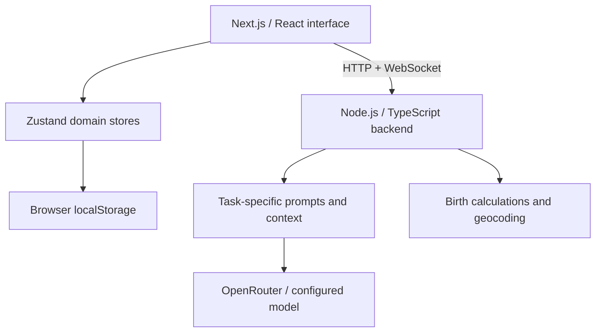

<div align="center">

# Friend in a Pocket

### A personal space for self-understanding, emotional growth, and spiritual exploration.

An AI companion that brings conversation, guided journaling, reflective exercises, and personal insights into one connected experience.


**[Explore the code](#architecture)** · **[Run locally](#getting-started)** · **[About the developer](#about-the-developer)**

</div>

## The idea

Personal growth rarely happens in a single conversation. It emerges through the things we share, the patterns we notice, and the questions we return to.

Friend in a Pocket explores how an AI assistant can support that process. Users shape their companion through onboarding, talk through everyday experiences, capture reflections in a journal, and explore different perspectives on themselves through an Insights space.

The product combines psychologically informed reflection with optional symbolic and spiritual exploration. Its long-term vision is a companion whose understanding becomes more useful as the user shares more of their story.

**Designed and built by Ana-Maria Rădulescu**, combining frontend engineering, backend development, AI integration, and a visual direction informed by an art and design background.

## What you can do

| Experience | How it works |
| --- | --- |
| **Create a personal companion** | Choose its name and symbolic preferences through onboarding. AI generates a reflection and compatibility guidance that inform the companion's conversational tone. |
| **Have contextual conversations** | Chat about self-worth, relationships, boundaries, emotional patterns, and personal growth. Responses use the onboarding profile, recent messages, and available birth-chart context. |
| **Build a reflection practice** | Receive daily journal prompts, record a mood, capture a small win, and save entries as numbered chapters. Drafts and entries persist between visits. |
| **Discover an inner portrait** | Generate a personality reflection from recent journal entries, completed exercises, and onboarding preferences; revisit it as new material accumulates. |
| **Explore reflective exercises** | Complete the Kokology-inspired *The Desert & The Cube* visualization and receive an AI interpretation with a question for further reflection. |
| **Explore birth-chart symbolism** | Enter birth details to calculate Sun, Moon, and rising signs where the required information is available, then receive an AI-written interpretation. |
| **Write to your future self** | Save a letter with a future opening date and encounter it inside the app when it becomes due. |
| **Use a more natural interface** | Dictate text in supported browsers, follow connection and response states, and install the app through its PWA manifest. |

## How personalization works

Personalization is implemented through **context engineering**: selecting user information and composing task-specific prompts at inference time.

| Context source | Current use |
| --- | --- |
| **Onboarding** | Produces a symbolic profile and companion compatibility guidance, which are included in the chat's system prompt. |
| **Conversation** | Supplies a bounded window of recent messages so replies can respond to the current discussion. |
| **Journal entries** | Feed the personality portrait generation flow, alongside mood, emotional language, and recorded small wins. |
| **Completed exercises** | Contribute their interpretations to the generated personality portrait. |
| **Birth chart** | Adds available placements to chat context, with instructions to reference astrology only when relevant. |

Chat and portrait generation currently have distinct context pipelines. The chat uses the onboarding profile, recent conversation, and optional chart placements; journal and exercise insights are synthesized separately on the Insights page. Connecting that evolving portrait back into chat is a next step toward the broader product vision.

The implementation adapts prompts and context rather than fine-tuning model weights. Conversation history is bounded, while the portrait pipeline selects up to 15 recent journal entries and truncates excerpts to manage prompt size.

## Engineering highlights

- **AI integrated across product flows.** Dedicated generation modules handle onboarding, conversation, daily prompts, exercise interpretation, personality portraits, and birth-chart interpretation.
- **Real-time interaction with explicit UI states.** Typed WebSocket events carry messages, typing indicators, and errors. The client handles connection status, bounded reconnection with exponential backoff, and intentional socket cleanup.
- **Separate application state by domain.** Zustand stores isolate chat, onboarding, journaling, and insights; browser storage restores the persistent parts of the experience.
- **Deterministic calculations alongside generative AI.** Birth placements are calculated in code using `astronomy-engine`, city coordinates from Nominatim, and timezone lookup via `geo-tz`. The model writes the interpretation rather than inventing the placements.
- **Task-specific response handling.** JSON extraction and control-character repair support onboarding and daily-prompt responses; feature-specific parsing checks the expected output before returning it to the UI.
- **Recoverable failures.** Daily prompts have a local fallback pool. The shared OpenRouter request layer applies a timeout and distinguishes credential, credit, model-availability, and rate-limit failures.
- **A considered visual experience.** SCSS Modules, Framer Motion, custom backgrounds, and contextual loading states support a calm, cohesive interface across the app.

## Architecture



| Layer | Technologies |
| --- | --- |
| **Frontend** | Next.js 16 App Router, React 19, TypeScript |
| **State and persistence** | Zustand, browser `localStorage` |
| **Interface** | SCSS Modules, Framer Motion, Lucide icons |
| **Backend** | Node.js native HTTP server, TypeScript, `ws` |
| **AI** | OpenRouter Chat Completions API, environment-configurable model, feature-specific prompts |
| **Birth calculations** | `astronomy-engine`, `geo-tz`, OpenStreetMap Nominatim |
| **Browser capabilities** | Web Speech API, service worker, web app manifest |
| **Deployment** | Vercel frontend, Render backend |

### Code map

| Location | Responsibility |
| --- | --- |
| [`client/app`](client/app) | App Router pages, layout, manifest, and generated icons |
| [`client/components`](client/components) | Chat, onboarding, journal, letters, and Insights interfaces |
| [`client/hooks`](client/hooks) | WebSocket lifecycle and microphone input |
| [`client/store`](client/store) | Domain state and browser persistence |
| [`client/lib`](client/lib) | API clients, backend configuration, and journal helpers |
| [`server/src/index.ts`](server/src/index.ts) | HTTP routes and WebSocket event handling |
| [`server/src/ai`](server/src/ai) | Prompt composition, generation modules, output parsing, and birth calculations |
| [`server/src/types`](server/src/types) | Backend request and message types |

## Getting started

**Prerequisites:** Node.js 22 or newer, npm, and an OpenRouter API key with access to your selected model.

```bash
git clone https://github.com/annarad111/Friend-in-a-Pocket.git
cd Friend-in-a-Pocket
```

### 1. Start the backend

```bash
cd server
npm ci
cp .env.example .env
```

Set these values in `server/.env`:

```dotenv
PORT=8080
OPENROUTER_API_KEY=your_openrouter_api_key
OPENROUTER_MODEL=openrouter/free
```

`OPENROUTER_MODEL` can be any compatible model available to your account. The example selects OpenRouter's free router; availability, usage limits, response style, and output reliability depend on the selected model. If the variable is omitted, the code defaults to `anthropic/claude-haiku-4.5`, a paid model.

```bash
npm run dev
```

Backend health: `http://localhost:8080/health`.

### 2. Start the frontend

In a second terminal, from the repository root:

```bash
cd client
npm ci
npm run dev
```

Open **http://localhost:3000**. Development defaults to the local backend. To override the connection, create `client/.env.local`:

```dotenv
NEXT_PUBLIC_API_BASE_URL=http://localhost:8080
# Optional: otherwise derived from the HTTP URL.
NEXT_PUBLIC_WS_URL=ws://localhost:8080
```

Keep the OpenRouter key in the backend environment only. For a hosted frontend, configure the public backend URL before building; `NEXT_PUBLIC_*` variables are embedded during the Next.js build.

### Available commands

| Directory | Command | Purpose |
| --- | --- | --- |
| `client` | `npm run dev` | Start the Next.js development server |
| `client` | `npm run build` | Create the production frontend build |
| `client` | `npm start` | Serve the production frontend build |
| `client` | `npm run lint` | Run ESLint |
| `server` | `npm run dev` | Start the backend with automatic restart |
| `server` | `npm run build` | Compile TypeScript to `dist` |
| `server` | `npm start` | Run the compiled backend |

## Current scope and next steps

This is an actively developed personal project with working end-to-end feature flows. Persistent onboarding, journal, letter, and Insights data currently live in the user's browser; chat history is session state. Selected user content is sent to the backend and AI provider when generating a response or insight. Letters become available within the app rather than through scheduled email delivery, and AI features require a network connection.

The next development priorities are:

- Bring the evolving personality portrait into chat through explicit, user-controlled memory.
- Add authenticated accounts and database-backed persistence across devices.
- Introduce token streaming and request cancellation.
- Expand automated coverage for context composition, response parsing, and socket reconnection.
- Add schema-based output validation, server-side request limits, and user data export controls.

The companion is intended for reflection and personal exploration. Psychological exercises and astrological interpretations are exploratory perspectives, not clinical assessments or established facts about a person.

## About the developer

**Ana-Maria Rădulescu — Frontend Developer & Artist**

I built Friend in a Pocket to explore the intersection of AI, human-centered interfaces, psychology, and creativity. It brings together my frontend background and artistic perspective with practical backend and LLM integration work.

[Portfolio](https://anaradulescu.xyz) · [GitHub](https://github.com/annarad111)
